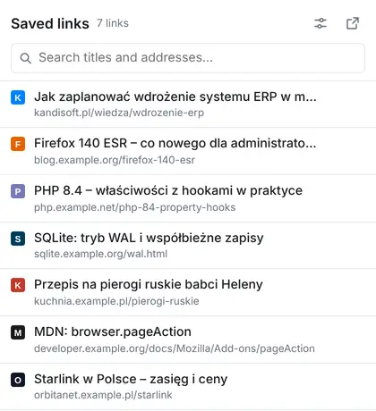

<div align="center">


# Pouch

**Save a page in one click. Come back to it when you have time.**

A lightweight read-later list for Firefox and Android — with optional sync through *your own* server.

[](LICENSE)
[](#installation)
[](extension/)
[](server/)
[](android/)
[](https://github.com/NorbertDudek/pouch/actions/workflows/ci.yml)

[Website](https://kandisoft.pl/uslugi/pouch/) ·
[Report a bug](https://github.com/NorbertDudek/pouch/issues/new?template=bug_report.yml) ·
[Request a feature](https://github.com/NorbertDudek/pouch/issues/new?template=feature_request.yml)

</div>

---

<p align="center">
  
</p>

## Why Pouch?

Pouch replaces the pile of open tabs and "someday" bookmarks with one simple list.
No account, no cloud, no tracking — your links stay in your browser, or on a server you run yourself.

## Features

**Firefox add-on**

- 📥 **One-click save** — the toolbar icon saves the current tab (URL, title and favicon). Saving the same page again refreshes its title instead of creating a duplicate.
- 🔎 **Instant search** — filter by title or address as you type; links open in a new tab.
- ✏️ **Edit entries** — rename an entry or fix its URL; duplicates are prevented.
- ↩️ **Undo delete** — removed something by mistake? Undo it for a few seconds.
- 🗂️ **Full-tab view** — open the list in a full browser tab when it grows long.
- 📄 **Pagination** — optional 10 / 20 / 50 items per page; search still covers the whole list.
- 🌗 **Light & dark theme** — follows your system setting.
- 🪶 **Lightweight** — no frameworks, no external libraries, works offline.

**Self-hosted sync (optional)**

- 🖥️ A single PHP script + SQLite database — no MySQL, no installer.
- 🔑 Every request requires a secret token; no cookies are sent.
- 🔄 Changes are pushed a few seconds after you save, edit or delete; new entries are pulled on browser start, when the list opens and every 15 minutes.
- 🧹 Deletions sync too; on conflicts the newer version wins; no duplicates across devices.

**Android app**

- 📲 **Share → Pouch** from any browser or app; the URL is extracted from shared text.
- 👆 Tap to open, swipe to delete, **+** to add manually (suggests the URL from the clipboard).
- 🔄 Same server and token as the add-on; pull-to-refresh syncs immediately.

## Installation

### Firefox add-on

> Requires **Firefox 140 or newer** (including ESR 140).

Install Pouch from [addons.mozilla.org](https://addons.mozilla.org/pl/firefox/addon/88c2bf54c4b44b7cb96f/) 
or download the signed `.xpi` from the [latest release](https://github.com/NorbertDudek/pouch/releases/latest).

### Android app

Download the APK from the [latest release](https://github.com/NorbertDudek/pouch/releases/latest).
Sync on Android requires a server reachable over **HTTPS**.

### Sync server (optional)

Requirements: any web hosting with **PHP 8.0+** and the **`pdo_sqlite`** extension.

1. Upload the [`server/`](server/) directory to your hosting.
2. Copy `config.example.php` to `config.php` and set a random token (at least 16 characters).
   Without a token the server rejects every request.
3. In the add-on options (and/or the Android app settings) enter the server URL and the token,
   then click **Save and sync** — Pouch checks the connection right away.

The SQLite database file is created automatically with a random, unguessable name.
For extra safety you can move it outside the public web root.

> ⚠️ Always use **https://**. Over plain http the token and your list are sent unencrypted —
> the options page warns you about it.

## Privacy

- Without a sync server, the list is stored **only** in Firefox's local storage.
- **No analytics, no telemetry, no ads.** The add-on declares to Mozilla that it collects no data.
- **Minimal permissions** — Pouch never reads page content; it only reads the URL and title of the tab you save.
- With sync enabled, data goes **only** to the server you configured.

## Repository structure

```
pouch/
├── extension/   Firefox add-on (Manifest V3, vanilla JS)
├── server/      Optional sync server (PHP 8.0+, SQLite)
├── android/     Android app
└── docs/        Logo and screenshots
```

## Development

### Firefox add-on

```bash
cd extension
npx web-ext run      # launch Firefox with the add-on loaded
npx web-ext lint     # validate the manifest and code
npx web-ext build    # create a .zip in web-ext-artifacts/
```

Or load it manually: `about:debugging` → **This Firefox** → **Load Temporary Add-on…** → select `extension/manifest.json`.

### Sync server

```bash
cd server
cp config.example.php config.php   # set your token
php -S localhost:8080
```

### Android app

Open the `android/` folder in Android Studio, or build from the command line:

```bash
cd android
./gradlew assembleDebug
```

## Roadmap

- [ ] Search and editing in the Android app
- [ ] Translations of the user interface
- [ ] Tags / folders

Have an idea? [Open a feature request](https://github.com/NorbertDudek/pouch/issues/new?template=feature_request.yml).

## Contributing

Contributions are welcome! Please read [CONTRIBUTING.md](CONTRIBUTING.md) first.
To report a security issue, follow [SECURITY.md](SECURITY.md) — please do not open a public issue.

## License

Pouch is released under the [Mozilla Public License 2.0](LICENSE).

---

<div align="center">
Made by <a href="https://kandisoft.pl">Kandisoft</a> · © 2026 Norbert Dudek
</div>
